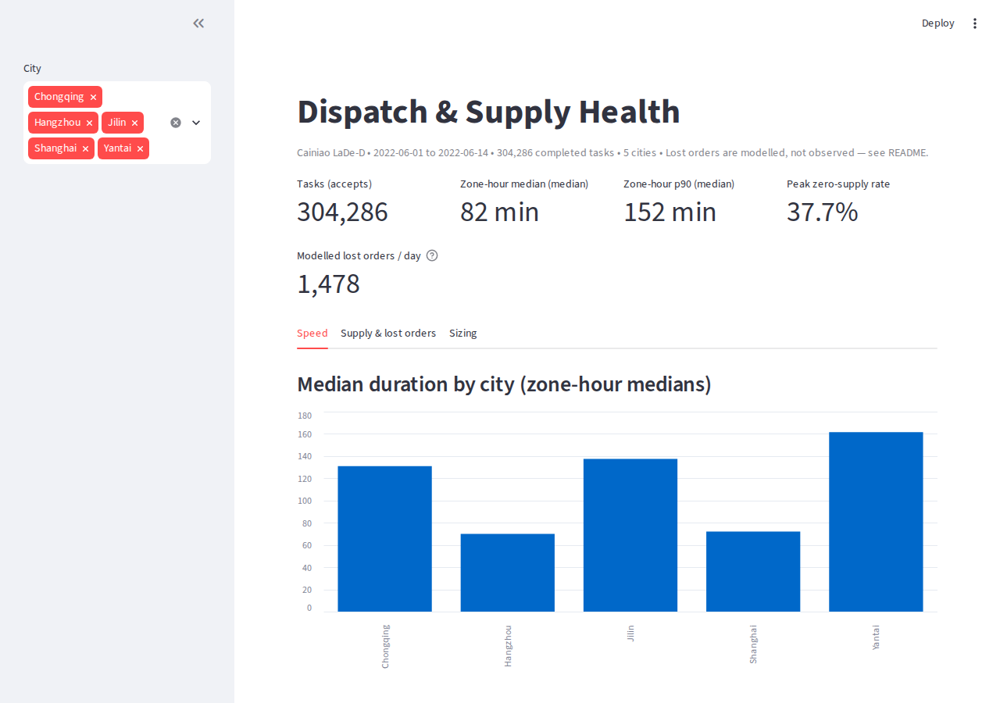

# Dispatch & Supply Diagnostics

**[Live Streamlit dashboard](https://dispatch-supply-diagnostics-6glxnd6zkj75bzka5t8cvy.streamlit.app/)**

**Problem:** in last-mile delivery, some zones are slow and some hours lose
orders — but "slow" and "lost" have different causes and different fixes.
This project separates them: a dispatch funnel (accept-to-deliver speed,
SQL CTEs + window functions) and a supply-demand imbalance table
(zero-supply hours, fulfilment vs a prior-days baseline, courier
utilisation), then sizes two interventions in courier-hours and cost.

**Source:** Cainiao LaDe-D, Hugging Face `Cainiao-AI/LaDe-D` (CC BY-NC 4.0),
the first public large-scale last-mile delivery dataset (10.7M packages,
21k couriers, 6 months). Sample used here: **2022-06-01 to 2022-06-14,
304,286 completed tasks, 5 cities** (Chongqing, Hangzhou, Jilin, Shanghai,
Yantai), 1,825 couriers in the window, 162 zones. The full 4.5M-row LaDe-D
is not shipped; the sample is reproducible from the source parquets with
the `ds` filter in `build_data.py` (601-614).



## KPIs (verified, 14 days)

| KPI | Value |
| --- | --- |
| Tasks (accepts) | 304,286 |
| Accept-to-deliver, median (event level) | **115 min** |
| Accept-to-deliver, p90 (event level) | **325 min** |
| Zone-hour median, median of hourly medians | 82 min |
| Peak-hour (07:00-22:00) zero-supply rate | **37.7%** of zone-hours |
| All-hours zero-supply rate | 58.1% (includes night, when almost no zone has a courier) |
| Modelled lost orders | **20,699 in 14 days = 1,479/day (6.8% of requests)** |
| Data quality | 0 FAIL, 1 WARN, 7 PASS (see below) |

**Read the two medians carefully:** 115 min is the median *order*;
82 min is the median *zone-hour median* (small, fast hours count the same
as big, slow ones). The notebook and dashboard label which one they use.

By city (event-level median / p90): Shanghai **81 / 242 min** (fastest),
Hangzhou 114 / 283, Chongqing 146 / 413, Jilin 159 / 369,
Yantai **215 / 516 min** (slowest). Morning 06:00-11:00 is the slowest
band (median 151 min, 146,365 orders; 08:00 alone is 58,888 requests),
evening 17:00-22:00 the fastest (60 min).

## Root causes (from `python/02_root_cause_and_sizing.ipynb`, 0 errors)

1. **Load is the speed driver.** Zone-hours with <=1 request per active
courier have median 35 min; load 2-3 → 66 min; load 5-10 → 108 min;
load >10 → **146 min** (p90 272 min). Correlation(load, hourly median)
= 0.22. OLS, holding city constant: each extra order per courier adds
**+5.2 min** to the hourly median (p < 0.001); city effects are large
(Hangzhou -71 min, Shanghai -54 min vs Chongqing). R² = 0.14 — load
matters, but it is not the whole story.
2. **Zero supply loses orders, not time.** In zero-supply hours no order
is accepted at all, so they never appear in the speed funnel — they only
show up in the hourly grid. Peak zero-supply hours are 977 per day.
Modelled lost orders concentrate in Hangzhou (635/day) and Chongqing
(362/day); worst zones: Hangzhou 60 (902 in 14 days), Hangzhou 96 (497),
Yantai 128 (447), Chongqing 103 (441).
3. **Do not build policy on 23:00.** Only 169 orders, median 5 min — a
small-n artefact.

## Sizing — speed vs cost (assumed courier cost CNY 30/h; LaDe has no pay data)

| Intervention | Courier-hours / day | Cost / day at CNY 30/h | Expected effect |
| --- | --- | --- | --- |
| **A. Cover zero-supply peak hours** — 1 courier in every zero-supply zone-hour, 07:00-22:00 | 977 | **CNY 29,323** | Against 1,417 modelled lost orders/day in peak hours; CNY 21 per modelled lost order *if all were recovered* (upper bound — recovery is not 1:1) |
| **B. Cut load to <=3** in every busy zone-hour | 3,904 | **CNY 117,111** | Busy hours move from median 108-146 min toward ~66 min (2-3 load bin) |
| B, lighter: cut load to <=5 | 1,571 | CNY 47,142 | Busy hours move toward ~79 min (3-5 load bin) |

**Recommendation:** start with A in Hangzhou and Chongqing (worst lost
zones first), then B in the morning peak only — not everywhere. B at
<=3 everywhere costs ~4x A for a speed gain, not a lost-order gain.

## Project structure

```
dispatch-supply-diagnostics/
├── data/
│   ├── raw/
│   │   ├── lade_delivery_events.csv      # 304,286 events, 22 cols
│   │   └── hourly_supply_demand.csv      # 54,432 zone-hours (full grid), 13 cols
│   └── processed/
│       ├── dispatch_funnel_clean.csv     # 17,784 zone-hours, validated funnel + supply
│       ├── funnel_hourly.csv             # output of sql/02
│       ├── supply_imbalance.csv          # output of sql/03 (by city, by band, worst zones)
│       └── dq_alerts.csv                 # output of sql/01
├── sql/
│   ├── 01_data_quality_checks.sql        # duplicates, negative durations, null GPS/zones
│   ├── 02_dispatch_funnel.sql            # CTEs + window functions, accept-to-deliver speed
│   └── 03_supply_demand_imbalance.sql    # zeroes rate, fulfilment %, courier utilisation
├── python/
│   ├── 01_run_sql_pipeline.py            # runs DuckDB queries, logs DQ alerts
│   └── 02_root_cause_and_sizing.ipynb    # executed, 14 cells, 0 errors
├── dashboard/
│   ├── dispatch_supply_health.py         # Streamlit app (the brief's .streamlit entry;
│   │                                     # Streamlit requires a .py file, so it is .py)
│   └── dashboard_preview.png             # real screenshot of the running app
├── build_data.py                         # builds the raw tables from LaDe-D parquets
├── build_notebook.py                     # generates the notebook
├── tests/                                # SQL, data, notebook, and dashboard checks
├── .github/workflows/ci.yml              # runs checks on pushes and pull requests
├── .streamlit/config.toml                # deployment settings
├── .python-version                       # Python 3.11
├── requirements.txt
├── requirements-dev.txt
├── LICENSE
└── README.md
```

## How to run

Use Python 3.11 from the project root. The required sample CSVs are committed,
so no download or database setup is needed.

```bash
python -m venv .venv
# Windows: .venv\Scripts\activate
# macOS/Linux: source .venv/bin/activate
pip install -r requirements-dev.txt

pytest -q                                  # SQL, notebook, data, and dashboard checks
python python/01_run_sql_pipeline.py       # DQ + funnel + imbalance + clean table
streamlit run dashboard/dispatch_supply_health.py
```

The 17 checks execute the DuckDB queries, the full analysis notebook, and the
Streamlit app. GitHub Actions runs them on every push and pull request, then
regenerates the SQL outputs and fails if the committed CSVs are stale, deleted,
or unexpectedly recreated.

To rebuild the sample from the original LaDe-D parquets, place the five city
files in `data/source/` (or set `LADE_SOURCE_DIR` to their directory), then run
`python build_data.py` followed by the SQL pipeline. Source parquets and local
virtual environments are ignored by Git.

To run a query directly, use `duckdb -c ".read sql/02_dispatch_funnel.sql"`
from the project root; the SQL reads `data/raw/...` relatively.

## Deploy to Streamlit Community Cloud

**Live app:** [Open the deployed dashboard](https://dispatch-supply-diagnostics-6glxnd6zkj75bzka5t8cvy.streamlit.app/).

1. Publish this directory as the GitHub repository `dispatch-supply-diagnostics`.
2. In [Streamlit Community Cloud](https://share.streamlit.io), choose **Create
   app** -> **Yup, I have an app** and select the repository.
3. Set the branch to `main` and the main file path to
   `dashboard/dispatch_supply_health.py`.
4. In **Advanced settings**, select Python **3.11**. No secrets are required.

When using **Paste GitHub URL**, paste the
[dashboard file URL](https://github.com/Lifewitdata/dispatch-supply-diagnostics/blob/main/dashboard/dispatch_supply_health.py),
not the repository root.

> **Troubleshooting:** If Cloud reports `No LaDe-D parquet files found` from
> `build_data.py`, the app's main file is set incorrectly. Select
> `dashboard/dispatch_supply_health.py` and reboot. `build_data.py` is an
> offline rebuild utility, not a Streamlit entrypoint.

The deployment reads only committed CSV files; it does not call an external
API or require a database. See the [official deployment
guide](https://docs.streamlit.io/deploy/streamlit-community-cloud/deploy-your-app/deploy)
for the current Cloud workflow.

## License

The software is released under the [MIT License](LICENSE). The LaDe-D source
data remains under **CC BY-NC 4.0**; the MIT license does not relicense the
underlying dataset or remove its noncommercial restriction.

## Definitions — read this before reusing a number

- **Requests** in a zone-hour = orders *accepted* in that hour.
**Completed** = orders *delivered* in that hour. Because delivery lags
accept by a ~2h median, completed can exceed requests in a single hour
band (e.g. evening deliveries include afternoon accepts). Over a full
day they match: 304,286 accepts vs 304,181 deliveries in the window
(105 deliveries spill past 14 June 23:59).
- **Eyeballs** = distinct couriers *on shift* in a zone-hour: a courier
is on shift in a zone-day from their first to their last accept there.
LaDe has no online/session feed, so this is a derived proxy, not a
separate data source. **Active couriers** = couriers who actually
accepted >=1 order in that hour. Utilisation = active / eyeballs.
- **Zeroes** = 1 when eyeballs = 0 in a zone-hour of the calendar grid.
The funnel table only has hours with at least one order, so its zeroes
rate is 0 by construction — read zeroes from the hourly grid / `sql/03`.
- **Expected requests** = expanding median of requests for the same zone
and hour-of-day over *prior* days only (no leakage). Day 1 has no
baseline. **Fulfilment %** = requests / expected requests (median across
zone-hours is reported; means blow up in tiny zones where expected is
0-1). **Lost orders (modelled)** = max(0, expected - requests), counted
**only** in hours with eyeballs <= 1. Counting every below-median hour
as lost would invent ~150k lost orders from ordinary variance.
- **Duration** = delivery_dt - accept_dt. Deliveries crossing midnight
get +1 day (1,978 orders in the raw download had a negative duration
before this fix; after it, 0). Durations >12h (3,684, 1.2%) are flagged
WARN and excluded from speed percentiles, not deleted.
- **Accept GPS** is null in 640 orders (0.21%, PASS); delivery GPS is
never null; no duplicate order_id; no date/ds mismatch.

## Data quality (sql/01, DuckDB)

| Check | Failed | Verdict |
| --- | --- | --- |
| duplicate_order_id | 0 | PASS |
| negative_accept_to_deliver_min | 0 | PASS |
| duration_over_12h | 3,684 (1.21%) | WARN |
| null_accept_gps | 640 (0.21%) | PASS |
| null_delivery_gps | 0 | PASS |
| null_zone_or_courier | 0 | PASS |
| delivery_before_accept_dt | 0 | PASS |
| date_ds_mismatch | 0 | PASS |

## Limitations — do not overclaim

- LaDe records **completed deliveries only**; lost orders are modelled,
not observed, and the model only counts thin-supply hours.
- Eyeballs are a derived on-shift proxy; LaDe has no online/session feed.
- Duration is accept-to-deliver, not pure travel time; it includes
waiting and batching at the station.
- The load-duration link is an association (R² 0.14); sizing is a
scenario, not a causal estimate. Courier cost CNY 30/h is an assumption.
- Sample is 14 days in June 2022, 5 Chinese cities. Do not generalise
to other seasons, cities, or platforms (this is Cainiao in China, not
Mrsool / Saudi — a different project, `delivery-eta-ops-copilot`,
covers the Saudi-adapted case).
